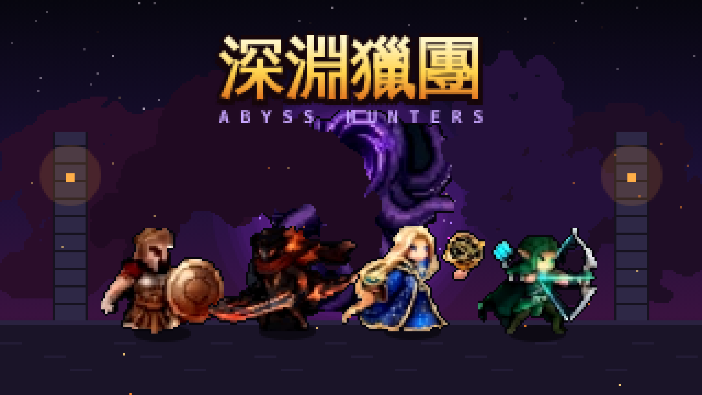

# 深淵獵團 Abyss Hunters



最多 **4 人共鬥**的像素風 Roguelike 地城網頁遊戲：5 章 50 關、三選一增幅與共鳴、事件關卡、5 個大型頭目，死亡後回營地永久強化角色與購買皮膚。

## 快速開始

```bash
cd dungeon-coop
npm install
npm start          # http://localhost:3000
```

1. 註冊帳號、登入，或按「遊客快速遊玩」（之後可在主畫面「綁定帳號」，進度全部保留）。
2. 按「建立房間」取得 **4 位數字房號**（例如 4829），朋友輸入房號即可加入（上限 4 人；遊戲進行中無法加入）。
3. 進入可自由走動的 **冥界聖殿**：
   - **職業祭壇**：站上去按互動鍵切換 4 種職業
   - **鏡像衣櫃**：切換／解鎖該職業的 4 款造型，房間內所有人即時同步並存入帳號
   - **訓練木樁**：測試連段、技能與大招傷害（不會死、浮動數字不重疊）
   - **出發傳送陣**：全員站上去按互動鍵「準備」→ 倒數 3 秒進入地牢
4. 全滅或通關後依進度獲得魂晶，自動回到聖殿；魂晶用於營地科技樹與造型。

部署到網路主機（Render、Fly.io、VPS…）時：帳號資料存於 `data/`（可用 `ABYSS_DATA` 指定），權杖簽章金鑰會自動產生在 `data/secret.key`（也可用 `ABYSS_SECRET`）。手機遊玩建議走 HTTPS。

## 角色與頭目模型

角色（16 款造型）與頭目（14 隻，爆炎核心除外）使用 `tools/ref/` 的參考圖切出：

```bash
pip install opencv-python-headless pillow numpy
python3 tools/extract_sprites.py          # 輸出到 public/assets/sprites/
```

腳本用 GrabCut 去背（深色角色另有身體位置提示）、縮成遊戲尺寸（角色 48px、頭目 92px 高）並加上黑色外框。
換掉 `tools/ref/heroes.jpg`、`bosses.jpg` 或調整腳本裡的裁切框即可更新模型；找不到圖檔時遊戲會自動改用程序化繪製的模型。

## 手機橫向

手機進房（建立／加入）時會自動要求全螢幕並鎖定橫向（Android Chrome 支援；iOS Safari 不支援鎖定，請關閉螢幕方向鎖定後橫放手機）。
直向時會出現提示，可在設定把「手機螢幕方向」改成「跟隨手機方向」。加入主畫面（PWA）後預設以橫向全螢幕開啟。

## 操作（自動偵測，也可在設定手動切換）

| 動作 | 電腦 | 手機 |
|---|---|---|
| 移動 | WASD／方向鍵 | 左下任意處按住出現動態搖桿 |
| 瞄準 | 滑鼠 | 自動瞄準最近敵人 |
| 普攻（連段） | 左鍵（遊俠長按蓄力） | 右下大按鈕 |
| 翻滾（無敵 0.25 秒） | 空白鍵 | 扇形按鈕「翻滾」 |
| 特殊技 | 右鍵／E | 「特殊」 |
| 大招 | Q／R | 「大招」 |
| 互動、救援 | F（救援需長按 2.5 秒） | 「互動」 |
| 增幅三選一 | 1／2／3 或點擊，R 重擲 | 點擊卡片 |

按鈕上會顯示冷卻轉圈與剩餘充能數字。Esc／☰ 開啟選單，M 開關音樂。

## 職業（數值見 `public/data.js` 的 `CLASSES`）

| 職業 | 普攻 | 翻滾 | 特殊技（充能／冷卻） | 大招（儲存上限） |
|---|---|---|---|---|
| 冥刃行者 | 雙刃四連斬，第四擊突刺 | 2 次 | 影襲飛刃 3／4 秒：標記敵人，衝刺穿過引爆 | 千影瞬獄殺 ×2：無敵連斬 8 次＋暗影爆炸 |
| 星隕法師 | 追蹤飛彈，第三擊爆裂彈 | 2 次 | 重力奇點 2／7 秒：黑洞牽引小怪 2.5 秒 | 諸神黃昏隕石 ×1：吟唱 0.8 秒的超大範圍隕石＋5 秒燃燒 |
| 重盾戰神（體型寬 20%） | 橫掃兩段＋躍起砸地暈眩 | 2 次 | 神盾反擊 2／5 秒：正面減傷 90%，0.3 秒內受擊＝完美格擋反彈 | 泰坦英靈領域 ×2：結界內 30% 生命護盾＋攻擊 +25% |
| 狩獵遊俠 | 點擊連射；長按蓄力，光圈縮到最小放開＝完美穿透箭 | 3 次，翻滾時自動射追蹤箭 | 毒藤捕獸夾 3／5 秒：定身 2 秒＋全隊易傷 20% | 阿波羅萬箭齊發 ×3：扇形光箭轟炸 |

共用動作狀態機：Idle → Move → Attack → Dash → Skill → Ultimate → Stagger → Downed。命中敵人累積大招能量。

**四人規則**
- 動態難度：1 人 1.0 倍血量／2 人 1.6 倍＋15% 怪量／3 人 2.2 倍＋30%／4 人 2.8 倍＋50%。
- 靈魂火炬：生命歸零變成可緩慢移動的火炬（15 秒），隊友靠近長按互動 2.5 秒救起（回復 40%）。
- 視覺降噪：自己的技能特效 100%，隊友的降為 35%。

## Roguelike 結構

- **5 章 × 10 關**：石之迴廊 → 苔蘚洞窟 → 熔岩深淵 → 冰封墓穴 → 虛空王座，每章第 10 關是頭目。
- **選路**：每關結束後會出現 2～3 扇門，**全員站到同一扇門前**就會前往該關卡：

| 關卡 | 內容 |
|---|---|
| 戰鬥 | 2～3 波敵人，清完每人三選一增幅 |
| 精英戰 | 帶金框的精英怪（血量 ×3.2），獎勵為「強化 +2」增幅 |
| 補給站 | 回復 35% 生命，用金幣買藥水、增幅卷軸、復活十字、磨刀石 |
| 武器鍛造 | 每人可升級一次武器（Lv3、Lv5 會進化） |
| 寶藏室 | 三個寶箱，其中一個是**陷阱寶箱**（寶箱怪或毒氣），仔細看會晃動 |
| 血之祭壇 | 獻上 25% 生命，換取「強化 +2」增幅 |

## 增幅與共鳴

8 個系列、41 種增幅，每人各自三選一（同一增幅可重複升級）。同系列累積 2／4／6 級觸發**共鳴**：

| 系列 | 2 | 4 | 6 |
|---|---|---|---|
| 烈焰 | 燃燒傷害 +50% | 燃燒的敵人死亡時爆炸 | 攻擊必定點燃，燃燒 ×2 |
| 冰霜 | 緩速機率 +15% | 緩速時機率直接冰凍 | 冰凍敵人受傷 ×1.6，死亡碎裂 |
| 雷霆 | 閃電機率 +10% | 閃電麻痺敵人 | 施放技能召喚全場雷暴 |
| 劇毒 | 中毒上限 +6 | 中毒傷害 ×1.6 | 滿 10 層引爆 |
| 鋼鐵 | 減傷 6% | 護盾全滿時傷害 +25% | 護盾破碎衝擊波、抵擋致命傷 |
| 疾風 | 攻速 +10% | 翻滾後必定暴擊 | 暴擊射出追蹤風刃 |
| 聖光 | 擊殺回血 | 救援 ×2 速度 | 施放技能治療全隊 |
| 暗影 | 傷害 +8% | 擊殺射出暗影飛刀 | 吸血 ×3、溢出治療轉護盾 |

## 敵人與頭目

- 每章 8 種專屬小怪（另有分裂體、小蜘蛛、該章的寶箱怪），**小怪只會出現在自己的章節**，頭目召喚的手下也是同章怪物（`npm test` 會檢查）。共 17 種 AI：追擊、跳躍、飛行、遠程風箏、衝鋒、砲台、投彈、自爆、召喚、治療同伴、正面持盾（要繞背）、瞬移、鑽地、雷射、環繞射擊、飛撲……
- 每章 3 隻頭目，每次冒險隨機遇到其中一隻，各有獨立的特殊機制。挑戰時畫面下方顯示血條、血量數字與百分比、硬直值、機制狀態：

| 章節 | 頭目 | 特殊機制 |
|---|---|---|
| 1 石之迴廊 | 巨岩魔像 | 岩甲：傷害 -60%，打出破綻才會碎裂；撞牆會暈眩 |
| | 骷髏將軍 | 戰旗：場上有戰旗時傷害 -80%，要先拆旗 |
| | 雙子石像鬼 | 一隻倒下會石化 8 秒後復活，必須在時限內擊倒另一隻 |
| 2 苔蘚洞窟 | 劇毒母蛛 | 蛛卵：6 秒內不打破就孵出小蜘蛛 |
| | 巨型食人花 | 4 條荊棘根存活時無敵，全拆後枯萎（傷害 ×1.5），之後會再長 |
| | 蘑菇王 | 血量 70%／40% 時分裂出分身並與分身換位 |
| 3 熔岩深淵 | 熔岩飛龍 | 定期飛上天（無法攻擊）並降下隕石，落地後是輸出時機 |
| | 烈焰惡魔 | 每次攻擊留下熔岩，場地越打越小 |
| | 爆炎核心 | 熱度計量表滿了會全場爆炸，打出破綻散熱或躲進冷卻區 |
| 4 冰封墓穴 | 冰霜巫妖 | 命匣存在時不會死亡 |
| | 冰霜女王 | 暴風雪時要躲到火盆旁取暖 |
| | 亡魂騎士 | 死亡印記：隊友靠在被標記者身邊分擔爆炸傷害 |
| 5 虛空王座 | 虛空主宰 | 黑洞吸引 |
| | 時之魔女 | 時間停止：子彈停在身邊，恢復時同時射出 |
| | 深淵之心 | 血量 75%／50%／25% 時召喚每位獵人的暗影分身 |

所有頭目還有硬直值（打滿倒地「破綻」，傷害 ×1.5）與半血狂暴。

## 配樂

全部為原創的晶片音樂（8-bit 風格，參考 Undertale 與元氣騎士那種旋律鮮明、帶迴聲的脈衝波主旋律＋三角波貝斯＋快速琶音＋噪音鼓），由 WebAudio 即時合成，不需要音檔：

| 場景 | 曲目 |
|---|---|
| 主選單 | 標題曲（C 大調，懷舊英雄感） |
| 營地 | 營地小屋（F 大調，溫暖） |
| 事件關卡 | 商店曲（G 大調，輕快） |
| 第 1～5 章 | 每章各一首：A 小調推進、D 多利安彈跳、E 和聲小調激烈、B 小調冰晶鐘聲、升 C 小調詭譎 |
| 頭目戰 | 頭目曲（每章移到不同調），第 5 章為最終頭目曲 |
| 結算 | 勝利、全滅小曲 |

M 鍵或選單按鈕可開關音樂。`tests/music-test.mjs` 會檢查每小節長度、強拍是否落在和弦音上、音域是否合理。

## 營地（永久成長）

全滅或通關後依進度獲得**魂晶**（完成關卡、擊敗頭目、擊殺數），存在瀏覽器裡。在選單的「營地」：

- **科技樹**（每個職業獨立，13 個節點）：生命、傷害、護盾、能量、暴擊、移速、冷卻、開局增幅、起始武器等級、每局自動復活一次、金幣加成、重擲次數，最後解鎖**職業絕技**（騎士劍氣、遊俠多重箭、法師炎爆、牧師神聖連結）。
- **皮膚**：每個職業 4 款（例如黑曜騎士、雪原獵手、冰霜賢者、櫻花巫女）。

線上模式下每位玩家使用自己瀏覽器裡的天賦與皮膚。

## 架構

```
dungeon-coop/
├── server.js            # 靜態檔、REST 帳號 API、WebSocket 房間（4 位數房號、伺服器權威 30Hz）
├── server/accounts.js   # 帳號：JSON 檔原子寫入、scrypt 密碼雜湊、HMAC 權杖、遊客綁定、獎勵結算
├── public/
│   ├── data.js          # 數值配置表：職業、造型、增幅、共鳴、科技樹、敵人、頭目、章節、人數縮放
│   ├── sim.js           # 共用遊戲邏輯：動作狀態機、充能、聖殿大廳、地牢、頭目機制
│   ├── art.js           # 程序化像素美術：64x64 角色、96x96 頭目、純黑墨影＋霓虹發光
│   ├── render.js        # 世界繪製、特效、光影、隊友特效降噪
│   ├── hud.js           # HTML HUD（隊伍、關卡、頭目血條、冷卻、提示、三選一）
│   ├── input.js         # 電腦／手機輸入自動切換、虛擬搖桿、扇形按鈕
│   ├── client.js        # 帳號畫面、房間、主迴圈、配樂
│   ├── camp.js          # 營地：科技樹、造型
│   ├── music.js         # 晶片音樂引擎（若 public/music/ 有音檔則優先播放）
│   ├── keyart.js        # 主視覺
│   ├── style.css        # 響應式樣式：Flex/Grid、clamp() 字級、安全區域
│   └── artsheet.html    # 開發用：所有角色與頭目模型總表
├── ASSET_PROMPTS.md     # Midjourney／Stable Diffusion／Suno 提示詞
└── tests/               # sim-test（全流程）、server-test（帳號與房間）、music-test（樂理）
```

開發測試：`ABYSS_DEV=1 npm start` 會開放測試指令（直接開始、跳到頭目、無敵），正式環境不要設定。

所有美術與音效都由程式即時生成，不需要任何外部素材。
